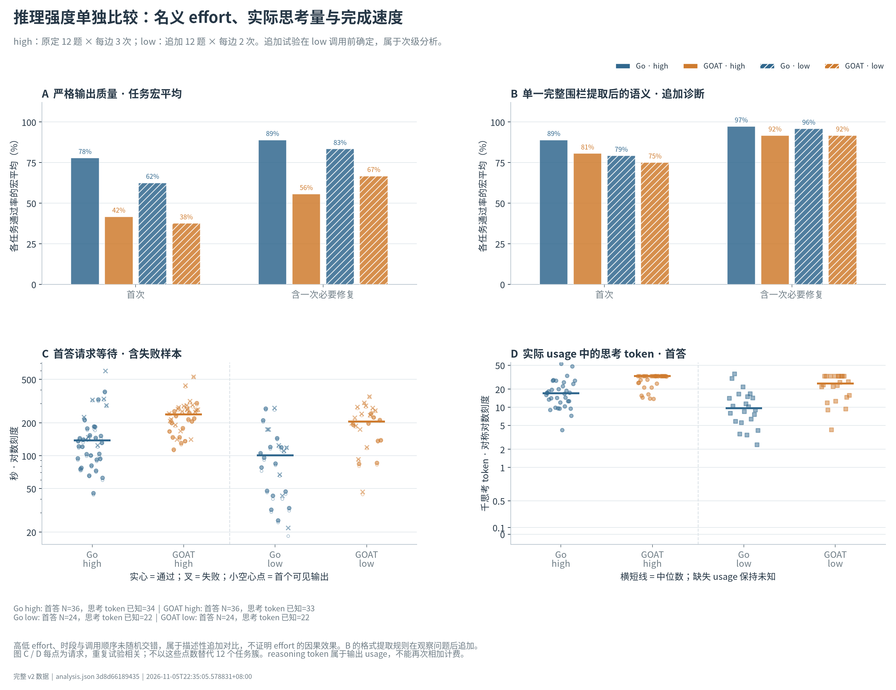
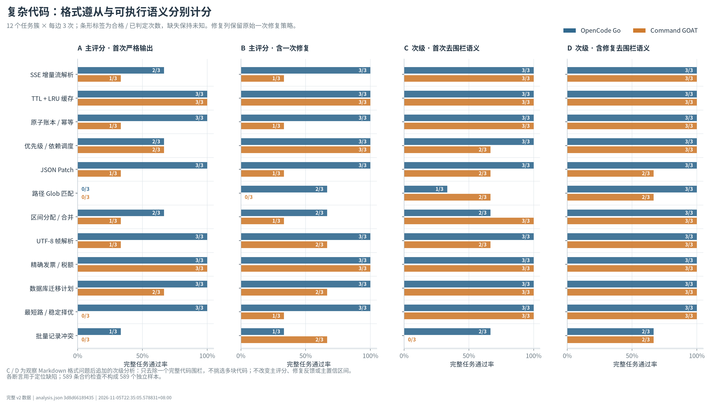
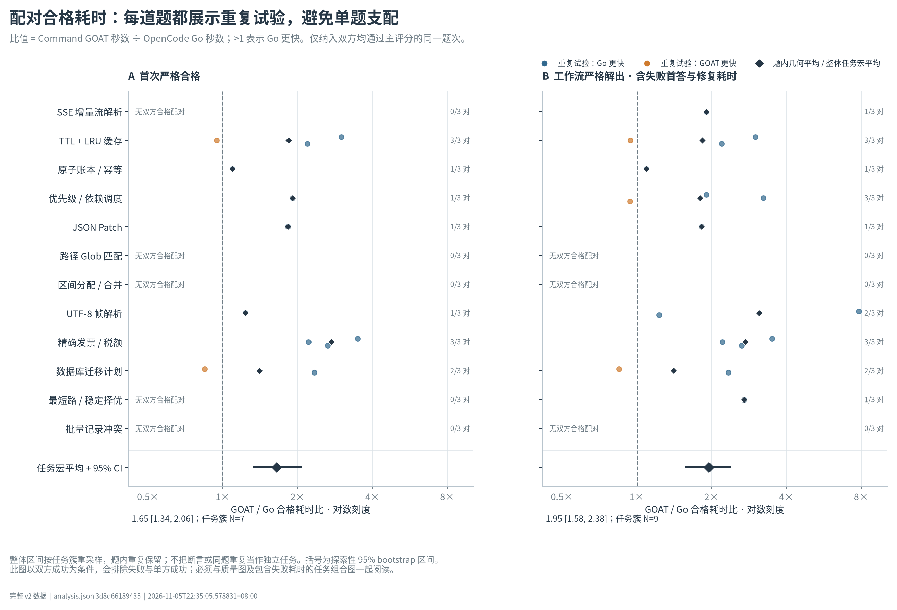
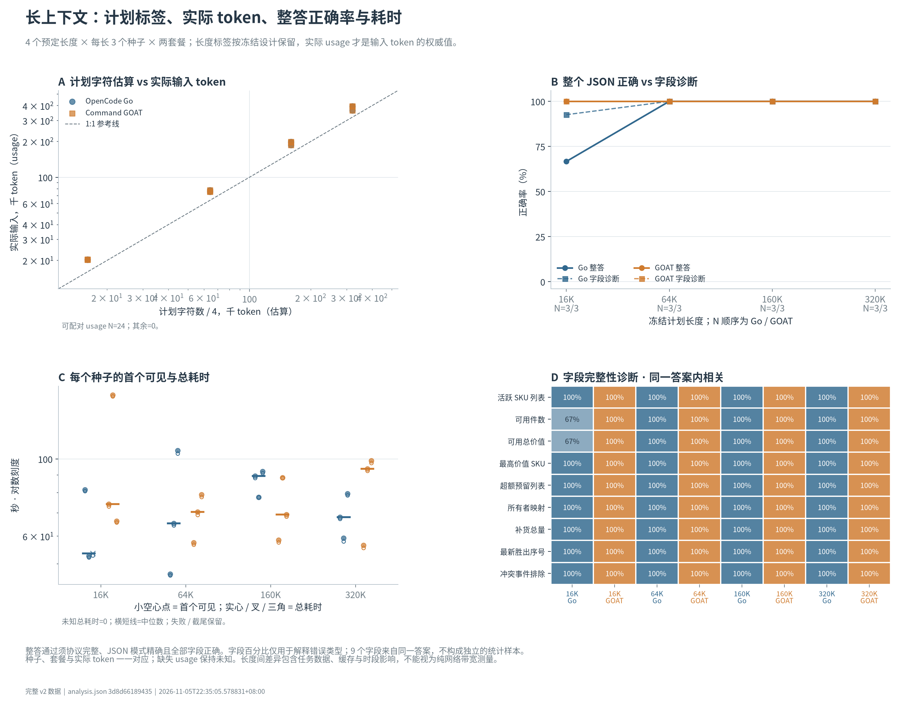
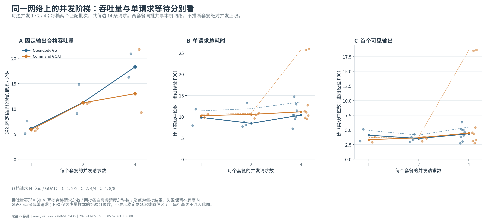
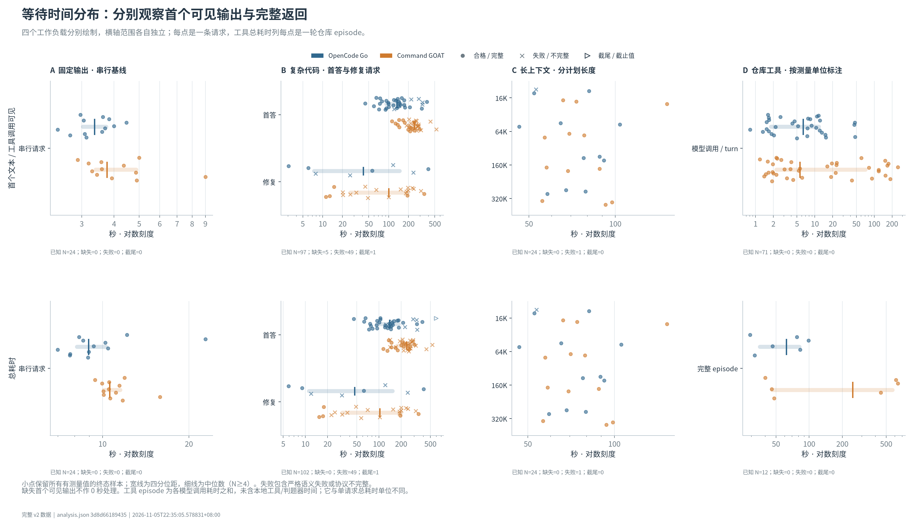
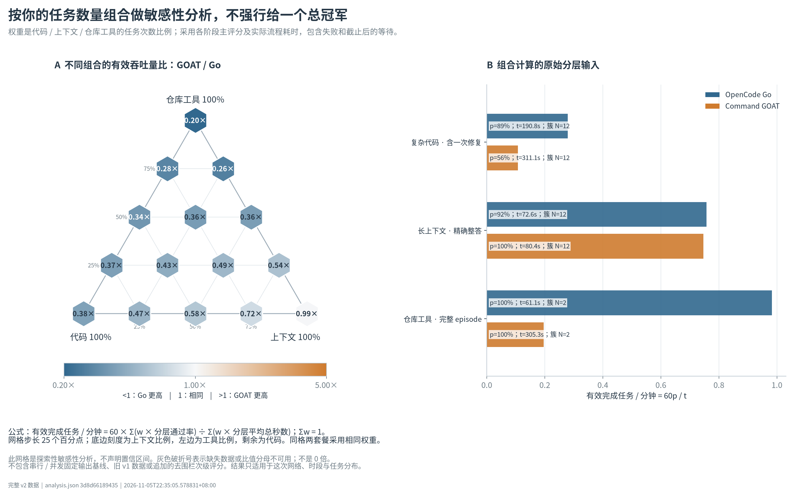

# DeepSeek V4.1 Flash：两套餐复杂实测与决策数据

测试窗口：2026-11-05T18:16:12.396912+08:00 至 2026-11-05T22:34:58.635421+08:00（北京时间）。本轮共 323 次启动记录、321 条客户端终端记录。

**范围：这台机器现有网络、现有 Magpie、标准 Flash 路由。结果是当前端到端使用体验，不是底模能力排行榜。**

## 结论：按这次的负载，下月优先保留 OpenCode Go

本轮比较的是这台机器现有网络与 Magpie 路由下的**服务体验**，不是判断两边背后的 DeepSeek V4.1 Flash 权重谁更聪明。固定题、参数、验收器和请求时窗尽量相同，但两边的思考 token、格式习惯、排队和路由响应仍可能不同；这些差异正是套餐实际交付的一部分。

**建议保留下月 OpenCode Go。** 对以代码实现、工具调用、失败后继续修复为主的日常使用，它在严格质量、反馈后完成率、等待时间和同额度完成量上同时领先，而且用户报告 OpenCode 可能还承受另一台电脑的并发负载，所以这个方向不是靠替 OpenCode 免除共享负载得到的。GOAT 的长上下文精确 JSON 是它最清楚的强项，但只在 12 组长上下文样本上比 Go 多通过 1 组，尚不足以抵消代码和工具流程上的大幅差距。

### 一个综合指标

主指标使用冻结 high 数据：

`有效完成数/分钟 = 60 × 成功任务数 ÷ 实际模型请求等待秒数之和`

失败首答和规定的一次修复都留在分母，以 12 个任务合同等权，而不是把 589 条断言当独立样本。

| 指标 | OpenCode Go | Command Code GOAT | GOAT / Go |
|---|---:|---:|---:|
| 严格有效完成数/分钟 | 0.2795 | 0.1072 | **0.383** |
| 以 Go=100 的指数 | 100 | **38.3** | 95% 区间 24.1–57.1 |
| 严格首轮通过率 | 28/36；宏平均 77.8% | 15/36；宏平均 41.7% | 差 −36.1 个百分点 |
| 一次修复后通过率 | 32/36；宏平均 88.9% | 20/36；宏平均 55.6% | 差 −33.3 个百分点 |
| 实际工作流平均等待 | 190.8 秒 | 311.1 秒 | 1.63 倍等待 |

按这个指标，GOAT 约为 Go 的 38.3%，即同一组合同在本次环境里 Go 的有效完成效率约为 GOAT 的 **2.61 倍**。删除任一合同后，GOAT/Go 仍只有 0.342–0.424，方向没有翻转。low 补充层也给出几乎相同的效率比 0.385，区间为 0.239–0.581。

### 质量

| high 严格口径 | Go | GOAT |
|---|---:|---:|
| 首轮严格通过 | 28/36，77.8% | 15/36，41.7% |
| 一次反馈修复后通过 | 32/36，88.9% | 20/36，55.6% |
| 首轮 Markdown Python 代码框次数 | 6/36 | 15/36 |
| 实际触发修复 | 8 次 | 21 次 |
| 首轮平均思考 token | 20,118 | 28,216 |
| 首轮平均输出 token，含思考 | 21,159 | 29,209 |

严格格式和验收行为都算交付质量，因此这是套餐面向 agent 的主结论。为判断代码框格式造成多少影响，又在不修改算法、不选多个代码块的前提下，只去掉覆盖整条回答的单个 Python 代码框并重新运行同一隔离验收器：

| 去框诊断 | Go | GOAT | GOAT−Go 的合同等权差 [95% 区间] |
|---|---:|---:|---:|
| 首轮源代码通过率 | 88.9% | 80.6% | −8.3 个百分点 [−25.0, +5.6] |
| 已记录修复后源代码通过率 | 97.2% | 91.7% | −5.6 个百分点 [−13.9, 0.0] |
| 假设自动去框的有效完成效率比 | — | — | 0.653 [0.465, 0.866] |

这说明 GOAT 的严格差距中确有很大一块来自 Markdown 包装；如果客户端会自动剥掉单代码框，原始算法结果的差距会明显缩小。即使采用这个偏宽松的事后假设，GOAT 的完成效率仍只有 Go 的约 65%，同额度合格工作流也仍明显更少。因而去框不是一项可以推翻套餐选择的结果。

high 逐题看，首轮 Go 在 7 个合同领先、3 个持平、1 个落后；含一次修复后，Go 在 8 个合同领先、3 个持平，GOAT 仅在 `record_conflicts` 领先 1 个合同。low 顺序相反地给予 GOAT 部分题目机会，但总体仍是 Go 领先，说明不是单一合同造成的结论。

### 速度

| 场景 | Go | GOAT | 解释 |
|---|---:|---:|---|
| 12 个串行固定短任务，完整返回 p50 | 8.94 秒 | 10.59 秒 | GOAT/Go 为 1.14；区间 0.92–1.36，短任务差异不算决定 |
| 串行首个可见输出 p50 | 3.36 秒 | 3.75 秒 | GOAT/Go 为 1.24，区间 1.01–1.55 |
| high 双方都正确的首答，几何平均耗时比 | — | — | GOAT/Go 为 1.65 [1.34, 2.06] |
| high 双方都最终解出的工作流，几何平均耗时比 | — | — | GOAT/Go 为 1.95 [1.58, 2.38] |
| 本地每边并发 4，完整返回 p90 | 13.48 秒 | 25.77 秒 | 小样本描述性结果，GOAT 尾部等待更高 |

复杂代码的耗时优势比短固定任务更稳定，也更符合 agent 实际工作负载。GOAT 在两个配置仓库题上均通过，但 `configuration_overlay` 的 Go 平均 86.25 秒、GOAT 566.0 秒；库存题则是 35.9 秒对 44.6 秒。配置题中两边所有 `run_tests` 调用都通过，GOAT 仍平均多出 2.33 个模型轮次，首次测试通过后还继续等待平均 231.2 秒。因此这段等待应描述为实际代理体验开销，而不是“失败测试后的合理修复”。

### 量与同额度完成数

2026-11-05 核验的公开规则是：两边基础套餐均 $10/月；只使用标准 DeepSeek V4.1 Flash 时，月度等值额度均 $100，滚动 5 小时/周窗口对应 $20/$50；GOAT 另列支付手续费。标准 Flash 的低峰/高峰价格为输入 $0.15/$0.30、缓存输入 $0.003/$0.006、输出 $0.60/$1.20 每百万 token，输出收费已包含思考 token，缓存输入已包含在输入中。下月续费时应再核对规则。

| high，统一低峰单价 | Go 严格 | GOAT 严格 |
|---|---:|---:|
| 完整成本已知工作流 | 34/36 | 33/36 |
| 同口径通过率 | 90.3% | 54.2% |
| 每个合格工作流合同等权成本 | $0.013391 | $0.022324 |
| 每 $100 的合格工作流推算 [95% 区间] | **6,742 [4,344, 10,322]** | **2,426 [1,429, 3,915]** |

只使用两边都已知完整成本的相同 trial，GOAT/Go 的同额度合格任务数比为 **0.339 [0.197, 0.524]**。去代码框并保留实际修复成本后为 0.578 [0.438, 0.745]；再假设客户端自动去框且可提前结束，则为 0.687 [0.527, 0.901]。三种口径都偏向 Go。

low 两边的已知成本题次分别为 Go 22/24、GOAT 21/24。每 $100 的合格工作流推算为 Go 10,089、GOAT 3,800；GOAT/Go 为 0.374 [0.239, 0.553]。low 是观察 high 后追加的，且与 high 在时间、缓存和顺序上混杂，所以只作为补充一致性，不与 high 合并。

这些是公开价格下的**合成任务等值模型**，不是账单、真实扣费或剩余额度。用户说当前额度并用不完，因此容量并不是下月的主要痛点；如果两边质量相近，仍应以速度和返工体验优先，而不是因“看起来更多 token”保留 GOAT。

### 长上下文、工具和混合负载

| 长上下文 | Go | GOAT |
|---|---:|---:|
| 完整九字段 JSON 通过 | 11/12 | **12/12** |
| 16K | 2/3 | **3/3** |
| 64K / 160K / 320K | 各 3/3 | 各 3/3 |
| 实际最高输入 | 约 396,914 token | 约 396,914 token |

Go 唯一失败是 16K 的 seed 2：响应完整，但九个字段中两个计算错误。字段来自同一答案，不能当作 108 个独立试验。各长度延迟方向不稳定：16K、64K 时 Go 的 p50 较短，160K 时 GOAT 较快，320K 时 Go 较快；所以长上下文没有稳定的全长度速度赢家。

工具流程两边都是 6/6 最终代码通过、6/6 完整结束，没有轮数上限。差距集中在代理行为和总等待，尤其配置叠加仓库，Go 平均 5.67 个模型响应、86.25 秒；GOAT 为 8 个响应、565.99 秒。

15 个任务次数组合中，GOAT/Go 从 0.200 到 0.985。只有“100% 纯长上下文”接近持平；只要组合里有代码或工具，方向都偏向 Go。该网格是情景敏感性，不表示所有用户存在唯一权重。

### 跨设备并发与剩余额度

本机能确认在测试窗口里观察到 **100 次 OpenCode 同模型后台调用、GOAT 为 0 次**。这 100 次调用与 25/148 个 OpenCode 终端请求发生重叠，累计重叠 77 次调用、807.15 个调用秒；其中 high 首轮有 10 个请求、55 次后台调用重叠。后半程的 low 和工具流程未见已落盘的重叠调用。后台日志只包含本机已完成请求，可能少算仍在进行或来自另一台电脑的负载，因此它是有方向的旁证，不是完整并发计数。

用户还补充：另一台电脑可能同时运行 OpenCode 任务。本机无法从 OpenCode 账号或 Magpie 取得另一端的请求数、token、重叠时长和剩余 5 小时/周额度。综合这两部分：

- 本次 OpenCode 的实际体验不是“独占空闲账号”的理想测试，外机负载若真实存在，会让 OpenCode 的领先更值得重视；
- 本地已经可见的不对称后台负载使原始延迟不能当作两边后端在完全空闲时的纯速度；不过 OpenCode 是在承担额外本地重叠、并可能承担外机负载时仍得到这些结果；
- 不能把所有 OpenCode 延迟都归因于套餐后端，也不能据此夸大成不受负载影响的稳定上限；
- 若下月保留 Go，应把另一台电脑的用量视为同一预算的一部分。当前你说额度烧不完，容量不是首要限制；若未来外机流量变大，先检查滚动窗口，而不是把 $100 乘二；
- GOAT 目前没有同等的跨设备负载证据，不能假定它也会受到完全相同的竞争。

### 证据边界与可能改变选择的条件

本轮共得到 321 条客户端终端请求记录，另有 2 条因本地采集器 SIGTERM 缺失终端的原始请求；它们经网关 499 证据识别后，用相同题目和参数整套重做，原始记录、未知用量和整对删除敏感性均保留。未知 usage 没有按零计费。路由头全部核验为目标 provider。

主结论只描述这 12 个手工代码合同、4 个上下文档、2 个合成仓库、本机 Magpie 和这次主要位于低峰时段的网络。它不是通用模型排行榜，也没有拿旧 v1 数据混算。去框、low effort 都是观察早期结果后追加的分析层。

只有在以下情况下，GOAT 才可能成为更合理选择：

1. 你的绝大多数真实任务都是超长上下文精确结构化提取，几乎没有代码生成或工具调用；GOAT 的 12/12 才有更大权重。
2. 你的实际客户端会稳定自动去框、去解释并且能避免 GOAT 的额外轮次，同时 OpenCode 外机流量让滚动额度成为硬限制。
3. 续费时价格、额度或模型路由发生实质变化，使同额度完成量关系反转。
4. 后续真实项目样本显示 GOAT 的语义质量明显更高；本次大多数严格失败是格式而非证明算法错误，但实际 agent 交付仍要求格式与工具循环。

你说明这些额度会在 11 月 12 日到期前用不完，因此未消耗的额度不是继续支付另一个套餐的理由；真正应保留的是更能把实际任务做完、等得更少、返工更少的服务。

就现有一揽子证据，推荐保留 **OpenCode Go**。如果你只保留一个，它在本次最贴近工程代理的负载里质量更稳、修复更少、等待更短、同额度有效完成数更高；GOAT 的长上下文强项真实存在，但还不足以单独改变整体选择。

## 样本与判断口径

| 层次 | 每套餐样本 | 要回答的问题 |
| --- | --- | --- |
| 复杂代码 high | 12 合同 × 3 次 = 36 题次 | 边界行为正确性、格式遵循、一次反馈后的恢复 |
| 复杂代码 low（后加对照） | 同 12 合同 × 2 次 = 24 题次 | 减少思考时是否更实用；与 high 分开分析 |
| 长上下文 | 4 个预设长度 × 3 个数据种子 = 12 组 | 覆盖、冲突、删除记录后的跨记录推理与精确 JSON |
| 多文件工具 | 2 个合成仓库 × 3 次 = 6 个流程 | 读文件、修复、运行测试和结束整个流程 |
| 短任务与并发 | 12 次串行 + 并发 1/2/4 各 2 批共 14 次 | 响应分布、首个可见输出、并行批次吞吐 |

high 是预先冻结主实验。low 和去代码框诊断是观察到早期结果后增加的补充分析，均单列。重复题次用于看稳定性；589 条代码断言和 102 条仓库断言不当作独立样本。

严格通过要求原始回答直接满足输出与执行合同。去框通过只允许删除覆盖整条回答的单个 Python/py/无语言代码框，再用同一隔离验收器检查；它不允许修改算法、选择多个代码块或删除解释文字。执行限制仍适用，因而它不是无限制的算法质量分数。实际修复、时间和用量都保留。

## 四种配置：正确率、等待和思考量

| 配置 | 题次/合同 | 首轮严格 | 首轮去框 | 反馈后严格 | 反馈后去框 | 首轮均秒 | 实际流程均秒 | 首轮思考 token 均值 |
| --- | --- | --- | --- | --- | --- | --- | --- | --- |
| OpenCode Go high | 36/12 | 77.8% | 88.9% | 88.9% | 97.2% | 166.0 | 190.8 | 20,118 |
| Command GOAT high | 36/12 | 41.7% | 80.6% | 55.6% | 91.7% | 235.5 | 311.1 | 28,216 |
| OpenCode Go low | 24/12 | 62.5% | 79.2% | 83.3% | 95.8% | 107.0 | 122.9 | 11,650 |
| Command GOAT low | 24/12 | 37.5% | 75.0% | 66.7% | 91.7% | 199.9 | 255.2 | 23,940 |

均值先在同一合同内平均，再让 12 个合同等权。实际流程等待是模型请求耗时之和，包含失败与必要的一次反馈修复；不包括本地验收器运行时间，也不是人工从打开任务到验收的总工时。

## high 的配对不确定性与单题敏感性

| 指标 | 估计 [探索性 95% 区间] | 合同数/配对题次 |
| --- | --- | --- |
| 首轮严格通过率差，GOAT−Go | -36.1% [-55.6%, -19.4%] | 12/36 |
| 反馈后严格通过率差，GOAT−Go | -33.3% [-52.8%, -13.9%] | 12/36 |
| 首轮均正确时耗时比 GOAT/Go | 1.649 [1.336, 2.055] | 7/12 |
| 流程均完成时耗时比 GOAT/Go | 1.948 [1.582, 2.383] | 9/17 |
| 严格有效完成效率比 GOAT/Go | 0.383 [0.241, 0.571] | 12/36 |

| 事后补充指标 | 估计 [探索性 95% 区间] | 合同数/配对题次 |
| --- | --- | --- |
| 首轮去框检查通过率差，GOAT−Go | -8.3% [-25.0%, 5.6%] | 12/36 |
| 修复后去框检查通过率差，GOAT−Go | -5.6% [-13.9%, 0.0%] | 12/36 |
| 首轮去框均通过时耗时比 GOAT/Go | 1.654 [1.339, 1.998] | 11/27 |
| 假设自动去框的完成效率比 GOAT/Go | 0.653 [0.465, 0.866] | 12/36 |

| 逐一删除合同 | 严格完成效率比 GOAT/Go |
| --- | --- |
| atomic_ledger | 0.409 |
| decimal_invoice | 0.368 |
| interval_allocator | 0.350 |
| json_patch | 0.420 |
| migration_plan | 0.381 |
| path_glob | 0.375 |
| priority_schedule | 0.362 |
| record_conflicts | 0.342 |
| shortest_route | 0.424 |
| sse_stream | 0.408 |
| ttl_lru | 0.361 |
| utf8_frames | 0.400 |

删除受采集器中断影响后重做的整个试验对：配对数 35，严格完成效率比 0.351 [0.230, 0.498]。原中断前 Go 的限制违规结果仍在原始记录与单独表中。

区间使用固定种子、10,000 次整个合同的成组重采样。通过率差大于 0 偏向 GOAT；耗时比大于 1 偏向 Go；有效完成效率比大于 1 偏向 GOAT。三种方向不能混用。

这些区间只反映本题库内重复与合同差异。12 个合成合同不足以代表所有代码工作；全对时经验区间可能退化为零宽，不证明未来零错误或两者等价。只比较均正确任务的速度也会筛掉困难失败题，应与完成率、失败时间一起读。

## 每道复杂代码题的重复结果

### high

| 合同 | 套餐 | 题次 | 首轮严格 | 首轮去框 | 反馈后去框 | 流程均秒 | 修复次数 |
| --- | --- | --- | --- | --- | --- | --- | --- |
| atomic_ledger | OpenCode Go | 3 | 100.0% | 100.0% | 100.0% | 151.1 | 0 |
| atomic_ledger | Command GOAT | 3 | 33.3% | 100.0% | 100.0% | 306.4 | 2 |
| decimal_invoice | OpenCode Go | 3 | 100.0% | 100.0% | 100.0% | 73.2 | 0 |
| decimal_invoice | Command GOAT | 3 | 100.0% | 100.0% | 100.0% | 199.7 | 0 |
| interval_allocator | OpenCode Go | 3 | 66.7% | 66.7% | 100.0% | 450.1 | 1 |
| interval_allocator | Command GOAT | 3 | 33.3% | 100.0% | 100.0% | 406.0 | 2 |
| json_patch | OpenCode Go | 3 | 100.0% | 100.0% | 100.0% | 158.8 | 0 |
| json_patch | Command GOAT | 3 | 33.3% | 66.7% | 66.7% | 410.8 | 2 |
| migration_plan | OpenCode Go | 3 | 100.0% | 100.0% | 100.0% | 122.6 | 0 |
| migration_plan | Command GOAT | 3 | 66.7% | 100.0% | 100.0% | 201.0 | 1 |
| path_glob | OpenCode Go | 3 | 0.0% | 33.3% | 100.0% | 425.4 | 3 |
| path_glob | Command GOAT | 3 | 0.0% | 66.7% | 66.7% | 419.8 | 3 |
| priority_schedule | OpenCode Go | 3 | 66.7% | 100.0% | 100.0% | 113.0 | 1 |
| priority_schedule | Command GOAT | 3 | 66.7% | 66.7% | 100.0% | 210.9 | 1 |
| record_conflicts | OpenCode Go | 3 | 33.3% | 66.7% | 66.7% | 284.5 | 2 |
| record_conflicts | Command GOAT | 3 | 0.0% | 0.0% | 66.7% | 326.4 | 3 |
| shortest_route | OpenCode Go | 3 | 100.0% | 100.0% | 100.0% | 125.4 | 0 |
| shortest_route | Command GOAT | 3 | 0.0% | 100.0% | 100.0% | 385.2 | 3 |
| sse_stream | OpenCode Go | 3 | 66.7% | 100.0% | 100.0% | 206.8 | 1 |
| sse_stream | Command GOAT | 3 | 33.3% | 100.0% | 100.0% | 389.5 | 2 |
| ttl_lru | OpenCode Go | 3 | 100.0% | 100.0% | 100.0% | 86.8 | 0 |
| ttl_lru | Command GOAT | 3 | 100.0% | 100.0% | 100.0% | 152.3 | 0 |
| utf8_frames | OpenCode Go | 3 | 100.0% | 100.0% | 100.0% | 91.7 | 0 |
| utf8_frames | Command GOAT | 3 | 33.3% | 66.7% | 100.0% | 324.8 | 2 |

### low

| 合同 | 套餐 | 题次 | 首轮严格 | 首轮去框 | 反馈后去框 | 流程均秒 | 修复次数 |
| --- | --- | --- | --- | --- | --- | --- | --- |
| atomic_ledger | OpenCode Go | 2 | 50.0% | 50.0% | 100.0% | 120.8 | 1 |
| atomic_ledger | Command GOAT | 2 | 0.0% | 50.0% | 100.0% | 304.7 | 2 |
| decimal_invoice | OpenCode Go | 2 | 50.0% | 50.0% | 100.0% | 152.3 | 1 |
| decimal_invoice | Command GOAT | 2 | 100.0% | 100.0% | 100.0% | 85.2 | 0 |
| interval_allocator | OpenCode Go | 2 | 50.0% | 50.0% | 100.0% | 270.1 | 1 |
| interval_allocator | Command GOAT | 2 | 0.0% | 50.0% | 100.0% | 426.9 | 2 |
| json_patch | OpenCode Go | 2 | 100.0% | 100.0% | 100.0% | 120.3 | 0 |
| json_patch | Command GOAT | 2 | 0.0% | 50.0% | 100.0% | 326.0 | 2 |
| migration_plan | OpenCode Go | 2 | 50.0% | 100.0% | 100.0% | 87.3 | 1 |
| migration_plan | Command GOAT | 2 | 100.0% | 100.0% | 100.0% | 206.2 | 0 |
| path_glob | OpenCode Go | 2 | 50.0% | 100.0% | 100.0% | 196.6 | 1 |
| path_glob | Command GOAT | 2 | 0.0% | 50.0% | 50.0% | 425.0 | 2 |
| priority_schedule | OpenCode Go | 2 | 100.0% | 100.0% | 100.0% | 60.6 | 0 |
| priority_schedule | Command GOAT | 2 | 50.0% | 100.0% | 100.0% | 253.6 | 1 |
| record_conflicts | OpenCode Go | 2 | 0.0% | 0.0% | 50.0% | 213.2 | 2 |
| record_conflicts | Command GOAT | 2 | 50.0% | 50.0% | 50.0% | 357.9 | 1 |
| shortest_route | OpenCode Go | 2 | 50.0% | 100.0% | 100.0% | 106.2 | 1 |
| shortest_route | Command GOAT | 2 | 50.0% | 100.0% | 100.0% | 135.3 | 1 |
| sse_stream | OpenCode Go | 2 | 50.0% | 100.0% | 100.0% | 77.5 | 1 |
| sse_stream | Command GOAT | 2 | 50.0% | 100.0% | 100.0% | 217.8 | 1 |
| ttl_lru | OpenCode Go | 2 | 100.0% | 100.0% | 100.0% | 32.7 | 0 |
| ttl_lru | Command GOAT | 2 | 50.0% | 100.0% | 100.0% | 96.7 | 1 |
| utf8_frames | OpenCode Go | 2 | 100.0% | 100.0% | 100.0% | 36.6 | 0 |
| utf8_frames | Command GOAT | 2 | 0.0% | 50.0% | 100.0% | 227.3 | 2 |

## 失败类型：不把格式和运行限制说成算法错误

| 思考档 | 套餐 | 阶段 | 归类 | 次数 |
| --- | --- | --- | --- | --- |
| high | Command GOAT | first | format | 15 |
| high | Command GOAT | first | restriction | 2 |
| high | Command GOAT | first | semantic | 1 |
| high | Command GOAT | first | transport | 3 |
| high | Command GOAT | repair | format | 15 |
| high | Command GOAT | repair | semantic | 1 |
| high | OpenCode Go | first | deadline | 1 |
| high | OpenCode Go | first | format | 6 |
| high | OpenCode Go | first | transport | 1 |
| high | OpenCode Go | repair | format | 3 |
| high | OpenCode Go | repair | restriction | 1 |
| low | Command GOAT | first | format | 11 |
| low | Command GOAT | first | semantic | 2 |
| low | Command GOAT | first | transport | 2 |
| low | Command GOAT | repair | format | 6 |
| low | Command GOAT | repair | transport | 2 |
| low | OpenCode Go | first | format | 4 |
| low | OpenCode Go | first | restriction | 2 |
| low | OpenCode Go | first | semantic | 1 |
| low | OpenCode Go | first | transport | 2 |
| low | OpenCode Go | repair | format | 4 |

format 表示完整代码框等输出合同问题；restriction 表示导入、名称或属性等运行限制；semantic 才是验收行为不符合预期。限制拒绝并未证明内部算法错误。提示已说明 Python 3.12、导入白名单、禁用 IO 和资源边界，但没有逐条说明 AST 对双下划线属性的禁用，属于题库执行合同的局限。

原始失败标签、规范化标签、每次反馈和去框后检查均在数据与证据包中。HTTP 200 本身不等于完成；完整流需要有效载荷、有效终止原因和 [DONE]。

## 长上下文：实际输入长度、正确性与等待

| 预设组 | 套餐 | 实际输入 token 均值 | 组数 | 完整 JSON 通过 | 字段检查通过 | p50 秒 | p90 秒 |
| --- | --- | --- | --- | --- | --- | --- | --- |
| 16K | OpenCode Go | 20,296 | 3 | 2/3 | 92.6% | 53.5 | 76.0 |
| 16K | Command GOAT | 20,296 | 3 | 3/3 | 100.0% | 74.1 | 136.8 |
| 64K | OpenCode Go | 76,499 | 3 | 3/3 | 100.0% | 65.2 | 97.6 |
| 64K | Command GOAT | 76,499 | 3 | 3/3 | 100.0% | 70.4 | 77.3 |
| 160K | OpenCode Go | 194,095 | 3 | 3/3 | 100.0% | 89.4 | 91.5 |
| 160K | Command GOAT | 194,095 | 3 | 3/3 | 100.0% | 69.2 | 84.5 |
| 320K | OpenCode Go | 384,495 | 3 | 3/3 | 100.0% | 68.1 | 77.2 |
| 320K | Command GOAT | 384,495 | 3 | 3/3 | 100.0% | 93.7 | 97.8 |

每组有 9 个精确字段，包含版本覆盖、删除、干扰 ID 和跨记录计算。全部字段同时正确才算该组通过。字段相关，不能把 108 个字段当作 108 个独立样本。预设组保持原标签，实际 token 由接口报告；没有测试 1M 上下文边界。

| 未通过字段所在组 | 套餐 | 字段 | 响应完整 |
| --- | --- | --- | --- |
| context-16k-seed-2 | OpenCode Go | available_units | 通过 |
| context-16k-seed-2 | OpenCode Go | available_value_cents | 通过 |

## 多文件工具流程

| 仓库 | 套餐 | 流程数 | 最终代码通过 | 完整流程成功 | 平均响应轮数 | 平均工具调用 | 工具错误 | p50 秒 | 轮数到顶 |
| --- | --- | --- | --- | --- | --- | --- | --- | --- | --- |
| configuration_overlay | OpenCode Go | 3 | 100.0% | 100.0% | 5.7 | 9.7 | 0 | 82.9 | 0 |
| configuration_overlay | Command GOAT | 3 | 100.0% | 100.0% | 8.0 | 12.0 | 0 | 612.5 | 0 |
| inventory_idempotency | OpenCode Go | 3 | 100.0% | 100.0% | 5.0 | 9.0 | 0 | 32.0 | 0 |
| inventory_idempotency | Command GOAT | 3 | 100.0% | 100.0% | 5.0 | 9.0 | 0 | 45.7 | 0 |

仓库一覆盖库存事务、幂等和状态回滚；仓库二覆盖配置叠加、来源跟踪和缺陷修复。模型能列目录、读文件、写指定源文件和跑固定测试；不能改测试或任意执行 shell。每流程最多 12 次模型响应，达到上限仍保留最终代码检查；“代码通过”和“模型正常结束整个流程”分别统计。仅两个仓库，不能推出大型真实项目的普遍成功率。

## 简单任务、首个可见输出与并发

| 阶段 | 每套餐并发 | 套餐 | 请求数 | 夹具通过 | 首个可见 p50 秒 | 完整 p50 秒 | 完整 p90 秒 |
| --- | --- | --- | --- | --- | --- | --- | --- |
| concurrency | 1 | OpenCode Go | 2 | 2/2 | 4.1 | 9.8 | 11.4 |
| concurrency | 1 | Command GOAT | 2 | 2/2 | 3.3 | 10.2 | 10.6 |
| concurrency | 2 | OpenCode Go | 4 | 4/4 | 3.5 | 8.4 | 11.9 |
| concurrency | 2 | Command GOAT | 4 | 4/4 | 3.7 | 10.5 | 10.8 |
| concurrency | 4 | OpenCode Go | 8 | 8/8 | 4.3 | 10.4 | 13.5 |
| concurrency | 4 | Command GOAT | 8 | 8/8 | 4.5 | 11.2 | 25.8 |
| serial | 1 | OpenCode Go | 12 | 12/12 | 3.4 | 8.9 | 12.0 |
| serial | 1 | Command GOAT | 12 | 12/12 | 3.8 | 10.6 | 11.9 |

| 串行配对指标 GOAT/Go | 估计 [95% 区间] | Go 更快/GOAT 更快 |
| --- | --- | --- |
| total_seconds_ratio_all_terminal | 1.142 [0.924, 1.363] | 9/3 |
| first_visible_seconds_ratio_all_terminal | 1.238 [1.014, 1.549] | 6/6 |

首个可见输出排除思考正文与 keepalive，只计最终正文或工具调用的首个非空增量；首事件可能只是思考，另存原始数据。串行指每套餐一个流，一对套餐共享本机网络；并发 4 则最多每套餐 4 流，共享链路最多 8 条被测流。并发只有每档两批，作描述性测量，不宣称测出了持续容量上限。

## 工具轨迹补充：测试通过后还在等待什么

| 仓库题次 | 套餐 | 写文件数 | 测试通过/失败次数 | 首次工具测试通过累计秒 | 首次通过后模型等待秒 | 最终代码 |
| --- | --- | --- | --- | --- | --- | --- |
| inventory_idempotency-r0 | OpenCode Go | 3 | 1/0 | 21.8 | 7.3 | 通过 |
| inventory_idempotency-r0 | Command GOAT | 3 | 1/0 | 33.4 | 6.5 | 通过 |
| inventory_idempotency-r1 | OpenCode Go | 3 | 1/0 | 25.0 | 6.9 | 通过 |
| inventory_idempotency-r1 | Command GOAT | 3 | 1/0 | 40.0 | 8.2 | 通过 |
| inventory_idempotency-r2 | OpenCode Go | 3 | 1/0 | 32.5 | 14.1 | 通过 |
| inventory_idempotency-r2 | Command GOAT | 3 | 1/0 | 36.7 | 9.0 | 通过 |
| configuration_overlay-r0 | OpenCode Go | 3 | 1/0 | 74.4 | 8.5 | 通过 |
| configuration_overlay-r0 | Command GOAT | 4 | 3/0 | 218.5 | 228.4 | 通过 |
| configuration_overlay-r1 | OpenCode Go | 4 | 2/0 | 70.5 | 28.1 | 通过 |
| configuration_overlay-r1 | Command GOAT | 3 | 2/0 | 465.8 | 172.7 | 通过 |
| configuration_overlay-r2 | OpenCode Go | 3 | 1/0 | 69.3 | 8.0 | 通过 |
| configuration_overlay-r2 | Command GOAT | 4 | 3/0 | 320.1 | 292.4 | 通过 |

这是事后轨迹诊断。累计时间按发出对应工具调用的那次完整模型响应计入；不是精确工具调用首字时刻，也不含工具执行。配置仓库的全部 run_tests 调用均通过，首次通过后仍有模型响应和进一步工具操作；不能把这些额外等待描述为失败测试后的修复，也不直接断言它们毫无作用。

## 量：公开额度相同，完成同一工作实际消耗可能不同

2026-11-05 核验：基础月费均为 $10，GOAT 另列支付手续费；只使用标准 DeepSeek V4.1 Flash，两边月度等值额度均为 $100，5 小时/周窗口均对应 $20/$50。[OpenCode Go](https://opencode.ai/v2/docs/console/go/)、[GOAT 套餐](https://commandcode.ai/docs/plans/goat)、[GOAT 窗口说明](https://commandcode.ai/docs/resources/usage-limits)。这是模型使用价值，不是现金返还。混用模型按各模型占用比例共享池，下月应以续费时规则为准。

标准版每百万 token 的新输入/缓存输入/输出：低峰 $0.15/$0.003/$0.60，高峰 $0.30/$0.006/$1.20。高峰是北京时间工作日 09–12、14–18；输出已包含思考，不能另加一次思考费用。缓存是输入的子集，不能同时按全额新输入重复计算。[OpenCode 价格表](https://opencode.ai/v2/docs/console/go/)、[Command 价格表](https://commandcode.ai/docs/resources/pricing-limits)。

| 已知部分；含失败与行政排除 | OpenCode Go | Command GOAT |
| --- | --- | --- |
| 客户端终端请求数 | 148 | 173 |
| 完整响应数 | 144 | 166 |
| 未知 usage，含缺失终端 | 5 | 8 |
| 输入 token | 2,171,759 | 2,234,190 |
| 其中缓存 token | 71,296 | 125,568 |
| 输出 token，含思考 | 1,345,373 | 2,454,635 |
| 其中思考 token | 1,215,280 | 2,310,543 |
| 按公开价格的等值估算 USD | 1.122507 | 1.789451 |

本轮没有刻意耗尽套餐，也没有观测满月可用量或精确扣费。缺失 usage 的请求费用未知，上表不是完整账单。具体配置的 $100 合格任务数推算见 quantity.json 与预算表；它依赖相同任务分布、公开单价及缓存模式，不是承诺。

| 配置 | 计算口径 | 已知成本题次/观察题次 | 纳入合同 | 每题等值成本 USD | 每 $100 合格任务估算 [95% 区间] |
| --- | --- | --- | --- | --- | --- |
| OpenCode Go high | 实际严格流程 | 34/36 | 12 | 0.013391 | 6,742 [4,344, 10,322] |
| OpenCode Go high | 去框后通过；保留全部实际修复成本 | 34/36 | 12 | 0.013391 | 7,260 [5,261, 10,369] |
| OpenCode Go high | 假设客户端自动去框；反事实 | 34/36 | 12 | 0.012898 | 7,538 [5,519, 10,509] |
| Command GOAT high | 实际严格流程 | 33/36 | 12 | 0.022324 | 2,426 [1,429, 3,915] |
| Command GOAT high | 去框后通过；保留全部实际修复成本 | 33/36 | 12 | 0.022324 | 4,231 [3,434, 5,402] |
| Command GOAT high | 假设客户端自动去框；反事实 | 33/36 | 12 | 0.018348 | 5,147 [4,243, 6,186] |
| OpenCode Go low | 实际严格流程 | 22/24 | 12 | 0.008672 | 10,089 [7,028, 15,335] |
| OpenCode Go low | 去框后通过；保留全部实际修复成本 | 22/24 | 12 | 0.008672 | 11,531 [8,449, 16,941] |
| OpenCode Go low | 假设客户端自动去框；反事实 | 22/24 | 12 | 0.008523 | 11,733 [8,581, 17,509] |
| Command GOAT low | 实际严格流程 | 21/24 | 12 | 0.018643 | 3,800 [1,891, 6,801] |
| Command GOAT low | 去框后通过；保留全部实际修复成本 | 21/24 | 12 | 0.018643 | 5,364 [4,081, 7,470] |
| Command GOAT low | 假设客户端自动去框；反事实 | 21/24 | 12 | 0.016204 | 6,171 [4,983, 8,042] |

上表统一按低峰单价重计已知 token 与缓存；如果 token、命中和修复模式相同，改按高峰价格时可用任务数减半。只纳入整个流程成本均已知的题次，两套餐可纳入的子集可能不同。公平的跨套餐比值另用两边都已知成本的相同题次配对，见下面。

| 思考档 | 计算口径 | 配对合同/题次 | 同额预算的 GOAT/Go 合格任务数比 [95% 区间] |
| --- | --- | --- | --- |
| high | 实际严格流程 | 12/32 | 0.339 [0.197, 0.524] |
| high | 去框后通过；保留全部实际修复成本 | 12/32 | 0.578 [0.438, 0.745] |
| high | 假设客户端自动去框；反事实 | 12/32 | 0.687 [0.527, 0.901] |
| low | 实际严格流程 | 12/20 | 0.374 [0.239, 0.553] |
| low | 去框后通过；保留全部实际修复成本 | 12/20 | 0.441 [0.337, 0.569] |
| low | 假设客户端自动去框；反事实 | 12/20 | 0.495 [0.385, 0.617] |

预算推算的分母、未知工作流数量、统一高低峰重计价与假设自动去框结果都独立保存，不能把未知成本当零或把推算当实际额外跑出的任务。

## 一个便于决策的指标：每分钟有效完成数

**有效完成数/分钟 = 60 × 成功任务数 ÷ 实际模型请求等待秒数之和。** 失败等待和必要修复都占分母；相对于 Go 的指数为该效率比 ×100。代码主指标用严格工作流；去框后假设能提前结束的结果只作单独的反事实分析。

下面组合权重是“任务次数占比”，不是时间占比、token 占比或账单占比。每类先计算各自通过率与均时，再按任务占比组合：60×Σ(占比×通过率)/Σ(占比×均秒)。Excel 保留可重算公式。

| 代码/上下文/工具 次数占比 | Go 合格数/分 | GOAT 合格数/分 | GOAT 指数，Go=100 |
| --- | --- | --- | --- |
| 0/0/100 | 0.983 | 0.197 | 20.0 |
| 0/25/75 | 0.919 | 0.241 | 26.2 |
| 0/50/50 | 0.860 | 0.311 | 36.2 |
| 0/75/25 | 0.807 | 0.439 | 54.4 |
| 0/100/0 | 0.758 | 0.746 | 98.5 |
| 25/0/75 | 0.624 | 0.174 | 27.9 |
| 25/25/50 | 0.592 | 0.213 | 35.9 |
| 25/50/25 | 0.562 | 0.275 | 48.8 |
| 25/75/0 | 0.534 | 0.386 | 72.3 |
| 50/0/50 | 0.450 | 0.151 | 33.7 |
| 50/25/25 | 0.430 | 0.185 | 43.1 |
| 50/50/0 | 0.411 | 0.238 | 58.0 |
| 75/0/25 | 0.347 | 0.129 | 37.2 |
| 75/25/0 | 0.333 | 0.158 | 47.4 |
| 100/0/0 | 0.280 | 0.107 | 38.3 |

这是情景计算，没有声称对所有用户存在唯一加权总冠军；也没有把不同任务的断言数当权重。去框反事实组合另在 CSV/JSON 中，方便看格式问题对实际客户端流程的影响。

## 采集中断、环境与结果边界

本地原 high 采集器在 18:45:36 收到 SIGTERM，退出码 143，发起者未知。两条请求缺失客户端终端记录，网关对应 499；不能把它们算成套餐故障，也不能把网关零 token 字段当成已测零用量。整个受影响试验对按相同题目与参数重做。另一个原已返回 Go 首轮因双下划线属性限制未通过，原评分与用量保留；主配对排除这三个明确 attempt ID，并报告删除替代整对的敏感性。

| 套餐 | 阶段 | 题次 | 客户端用量/耗时 | 网关状态/耗时（独立证据） |
| --- | --- | --- | --- | --- |
| Command GOAT | core_first | record_conflicts-r0 | 未知 | 499/208.453 秒 |
| OpenCode Go | core_repair | record_conflicts-r0 | 未知 | 499/47.129 秒 |

因此完整指计划可评估队列在注明配对替换后完成；并不表示每个原始请求都获得最终答案。原始启动、终端、排除清单和配对重做记录全部保留。

模型路由固定为 `opencode-go/deepseek-v4.1-flash` 与 `commandcode-plan/deepseek/deepseek-v4.1-flash`；没有 Fast 变体或自动跨套餐回退。温度 0、输出上限 65,536。相同 high/low 请求标签不保证上游内部思考预算完全相同。

同题在同一批次近同时请求，代码每套餐最多两条被测流。测试保留本机原有后台使用，不停止其他应用；background-load.json 只聚合可见的已落盘同模型后台记录，不能据此建立速度变化的因果关系。

用户在采集中途补充：另一台电脑可能同时运行其他 OpenCode 任务，因此 OpenCode 可能承受跨设备、共享账号的并发与额度竞争。本机 Magpie 日志看不到另一台机器的请求数、token、重叠时长或剩余滚动额度，不能把这些负载伪造成精确观测；它作为外部负载敏感性保留。若 OpenCode 在此背景下仍保持同等或更高质量调整吞吐，其优势方向更可信；若只是 GOAT 速度领先，则对速度归因应更保守。

本轮主要观察低峰时段。前轮高峰只有 6 个短任务配对，这轮有 12 个；二者常规速度方向不同，说明不能用一个时段代表全月，但也不能将方向变化直接归因于高低峰、排队或网络中的某一个因素。前轮 50 调用没有混入这轮置信区间或指数，严格评分口径也不同。

模型生成的代码在 bwrap 新文件系统、网络与 PID 命名空间运行，不可访问用户目录、配置或凭据；15 秒 CPU、20 秒验收墙钟、768 MiB 内存，Python 3.12.3。独立审查复验全部参考实现、故意错误实现及 400 个额外随机 oracle 案例，仍不能证明题库覆盖所有真实缺陷。

单次响应应用门限为 600 秒，建立响应后可关闭套接字；异常的响应头前持续零碎传输可能超过该门限，已通过本地网络试验记录为采集器边界。因此不把这个门限描述成所有路径上的严格绝对硬截止。

low 在 high 之后测试，思考强度、顺序、负载与缓存可能混杂；它是实用配置对照，不能当成随机化因果实验。没有修改套餐、支付、网络代理或真实项目，也没有自动取消任何订阅。

## 文件与复核

- `DeepSeek套餐扩展实测.xlsx`：汇总、逐题、上下文/工具、任务组合公式、调用记录、用量与中断、同额度推算。

- `analysis.json`、`quantity.json`：完整统计定义和结果；`tables/` 是可筛选 CSV，每个表保持字段原名。

- `magpie-v2-evidence.zip`：冻结题库、脚本、原始最终答案、工具轨迹、每次评分、提示哈希、负对照、审查及恢复证据；没有 API 密钥和思考正文。

- `SHA256SUMS.json`：交付文件哈希。复算分析不发网络请求；重新执行采集脚本会消耗现有套餐用量。

分析生成时间：2026-11-05T22:35:05.578831+08:00。本报告由本轮数据生成，决策评述另经人工逐项核对。
